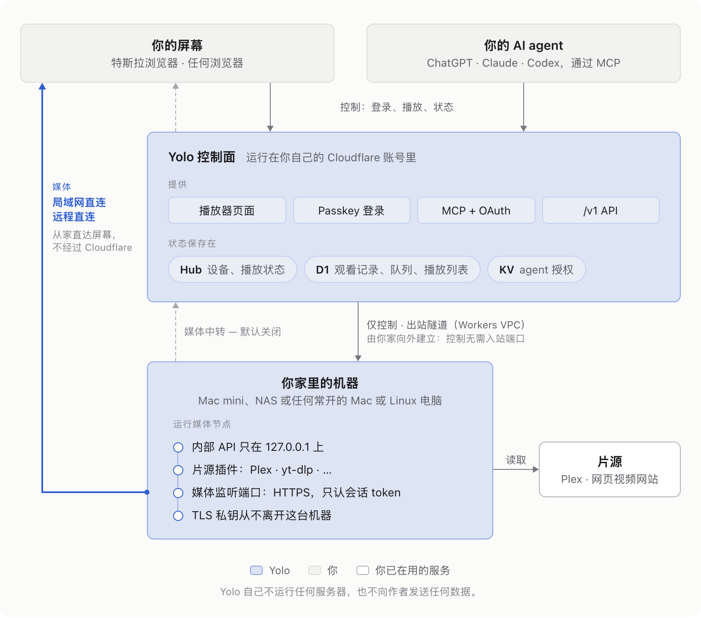

# Yolo

[English](README.md) | 中文

**Yolo 是一个私人的、由 agent（智能体）驱动的媒体服务。**它的播放器运行在特斯拉的浏览器或其他任何浏览器里，你的 AI agent（ChatGPT、Claude、Codex）通过 MCP 控制播放，整个服务运行在你自己的 Cloudflare 账号和你家里自己的机器上，播放的是你自己的片源。

> 在车上，请只在停车时或作为乘客使用 Yolo。遵守当地法律，只播放你有权访问的媒体。Yolo 与特斯拉或 Plex 没有任何关联。

## 每一部分都归你所有

- **没有 Yolo 服务器。**控制面是你 Cloudflare 账号里的一个 Worker，挂在你自己的域名上，没有域名时挂在你账号免费的 workers.dev 地址上；媒体节点是你家里机器上的一个进程。你的实例不调用 Yolo 项目运行的任何服务。
- **不向我们发送埋点。**Yolo 没有任何分析统计，也不回传数据。你的屏幕只把播放诊断发到你自己的 Workers Logs，并且先去掉其中的 token。
- **用户本人只用 passkey 登录。**没有密码，也没有邮件重置。第一个 passkey 和每一次重置都需要一个 6 位数字码，而只有你家里的机器能签发它。
- **媒体直接从你家里来。**屏幕通过 HTTPS 从节点取视频：在家庭网络里走节点的内网地址；你打开远程访问后，在其他任何地方经过路由器上的一个端口。某块屏幕没有可用的直连路径时，你的 Worker 经你自己的 Cloudflare 账号为它中转媒体，所以从第一次部署起，每块屏幕都能播放。
- **开源。**Yolo 采用 MIT 许可证，你从本仓库的发布标签部署它，所以你能读到自己运行的代码。

## 工作原理

<!-- Source: .github/readme/architecture.html. Re-render the images with: node scripts/render-readme-diagram.js -->
<picture>
  <source media="(prefers-color-scheme: dark)" srcset=".github/readme/architecture-zh-dark.png">
  <source media="(prefers-color-scheme: light)" srcset=".github/readme/architecture-zh-light.png">
  
</picture>

Worker 承载控制，只在没有直连路径可用时才承载媒体。它经由 Workers VPC 和一条 Cloudflare Tunnel 访问节点的内部 API，这条隧道由 cloudflared 从你家里向外建立。每块屏幕的媒体走第一条可用的路径：

1. **局域网直连。**在家庭网络里，屏幕会从节点在内网地址上的 HTTPS 监听端口取流。它用的是你域名区里的一个仅 DNS（不代理）名称和一张 Let's Encrypt 证书，证书的私钥从不离开节点。
2. **远程直连。**你打开远程访问后，其他任何地方的屏幕（包括用 LTE 的车）都能经过路由器上的一个端口，访问节点的远程监听端口（默认 9444）。节点通过 PCP、NAT-PMP 或 UPnP IGD 向路由器申请这个端口，定期续期，并在停止时删除映射；如果路由器对这三种协议都不响应，就由你手动转发端口。这个监听端口有自己的、指向你家公网 IP 地址的仅 DNS 名称和自己的 Let's Encrypt 证书，你的 Worker 会先从家庭网络之外确认端口能访问，然后才让屏幕使用它。
3. **中转。**Worker 在你自己的 Cloudflare 账号里把节点的媒体转发给屏幕，它是最后一条路径。中转是自动的：屏幕只在没有直连路径可用时才使用它，这可能发生在一条流开始时，也可能发生在直连的流中途失败时；一旦又有直连路径可用，下一条流就回到直连路径。直连路径排在前面，因为它们更快，也不消耗 Cloudflare 的带宽；中转的速率上限是 4.8 Mbps。Settings > Media paths 用来把中转设为 Automatic（自动）、On（开）或 Off（关），并显示每块屏幕最近一次用的路径。

[Agent Notes](.agents/notes/README.zh.md) 解释了每一部分以及为什么这样构建。可以从[整体拆分](.agents/notes/implemented/architecture/2026-10-07-control-plane-on-cloudflare-media-node-at-home.zh.md)、[经 Workers VPC 访问节点](.agents/notes/implemented/architecture/2026-10-08-workers-vpc-node-access.zh.md)、[局域网直连播放](.agents/notes/implemented/feature/2026-10-12-lan-direct-play.zh.md)和[媒体流离开 Worker](.agents/notes/implemented/architecture/2026-10-13-media-off-the-worker.zh.md)读起。

## 按下播放时发生了什么

1. 你在一块屏幕上打开你的站点，你的 Worker 返回播放器页面。
2. 屏幕用它的设备凭据完成认证，并连接 Hub；这个凭据是你用 passkey 批准它配对时一次性发给它的。Hub 列出已就绪的媒体路径，屏幕同时探测所有路径，按局域网直连、远程直连、中转的顺序，选用第一条有响应的路径。
3. 你点一下播放，或者某个 agent 通过 MCP 调用 `play`。Worker 把请求交给 Hub，Hub 经由 Workers VPC 请节点为这块屏幕的路径准备一个会话。片源插件（Plex、yt-dlp 等）告诉节点从哪里读取媒体，节点返回这个会话的媒体 token，以及它所服务路径的源（origin）。如果这块屏幕没有可用的直连路径，流就经中转传来。只有在你关掉了中转时，Hub 才会在节点做任何工作之前以 `media_unreachable` 拒绝；屏幕随后会显示原因和修复办法：重新打开中转，或者要转发的那个路由器端口。
4. 如果一条流在它的路径上失败，屏幕会在同一位置换到下一条路径继续播放，之后的流再重新选用最好的路径。
5. 媒体字节从节点流向屏幕。在两条直连路径上，TLS 就终止在节点本身。
6. 屏幕上报播放位置，Hub 把你的进度存进 D1，所以任何一块屏幕或任何一个 agent 都能从你停下的地方续播。

## 谁能看到什么

| 谁 | 能看到什么 |
|---|---|
| Yolo 项目及其作者 | 看不到你实例的任何东西：Yolo 不运行任何服务器，也不回传任何数据。 |
| 你的 Cloudflare 账号 | 控制数据（你的设备、agent、观看记录、队列、播放列表、播放状态，以及每块屏幕最近一次的播放测量数据）以及你自己的 Workers Logs。媒体字节只限走中转的流：中转处于默认的自动模式时，只在某块屏幕没有可用的直连路径时才有；你关掉中转时则完全没有。 |
| 你接入的 agent | 它们调用 Yolo 的工具时得到的返回内容，限于你授予的权限范围：状态、设备、片库、搜索结果、队列、播放列表、观看记录、条目的详情、章节和字幕文本，以及屏幕的播放状况（它的流、缓冲、卡顿和媒体路径）。有 `read` 权限的 agent 在被要求时还能取你视频的画面和故事板，这些画面由你的节点从片源读取，从不截取屏幕。封面以你自己源（origin）上的图片链接交给它们，不用登录就能打开，所以在旧聊天里也一直有效：任何拿到链接的人，例如被你分享了聊天的人，都能看到那一张封面，从而知道这部作品在你的片库里，直到你在设置里重置图片链接。 |
| 收到你分享链接的朋友 | 链接指定的那一个视频，连同它的标题和封面，为期 7 天，或者到你在设置里撤销这个链接为止；他们把链接转发给谁，谁就能看到同样的内容。你 Yolo 里的其他东西都看不到（[分享链接](.agents/notes/implemented/feature/2026-10-20-share-links.zh.md)）。 |
| 片源网站和 Plex | 节点为你要播放的内容及其缩略图发出的请求，来源是你家的 IP 地址。 |
| 屏幕连接的第三方 | 没有：屏幕只和你的 Worker 及你的节点通信，播放器的字体和所有图片都来自你自己的源。 |
| 公共互联网 | 你的主机名和节点的名称，它们出现在 DNS 和证书透明度（Certificate Transparency）日志里。使用局域网直连时，还有 DNS 里节点的内网地址。使用远程直连时，还有 DNS 里你家的公网 IP 地址，以及唯一一个只提供带授权 token 的媒体和一个可达性探测的 HTTPS 端口。 |

远程直连会公开你家的公网 IP 地址，Plex 的远程访问也是如此；它的名称进入证书透明度日志后不久，扫描器就会找到这个端口。如果你不想这样，就保持远程访问关闭：家里的屏幕照样直连播放，离开家时则通过中转播放。

## 安全模型

Yolo 的安全建立在小而明确的边界和你能读到的代码上：

- **passkey。**用户本人只用 passkey 登录。注册第一个 passkey、或重置全部 passkey 所需的配对码，由节点在本地的 Unix socket 上签发，Worker 和互联网都访问不到这个 socket；配对码 15 分钟后过期，只能用一次，输错五次即作废（[用户本人登录](.agents/notes/implemented/architecture/2026-10-08-passkey-owner-sign-in.zh.md)）。
- **设备配对需要你批准。**屏幕显示一个二维码；你扫码、登录，核对屏幕的短码和名称，然后点 Allow。短码只能用一次，10 分钟后过期（[设备配对](.agents/notes/implemented/feature/2026-10-07-device-code-pairing.zh.md)）。
- **凭据只存哈希，并按 scope 限权。**D1 只保存设备凭据的哈希，并在每次请求时核对，所以移除一台设备会立即切断它。agent 拿到的 OAuth token 限于你允许的 `read`、`control` 和 `manage` scope；访问 token 一小时过期，KV 里只存 token 的哈希（[OAuth](.agents/notes/implemented/architecture/2026-10-07-oauth-authorization-server.zh.md)）。
- **每个会话一个媒体 token。**每个媒体 URL 都带着一个为单个播放会话签发的 HMAC 签名 token，只在这个会话存续期间有效，最长 12 小时；媒体请求不用 cookie（[媒体 token](.agents/notes/implemented/architecture/2026-10-07-same-origin-media-passthrough.zh.md)）。
- **内部 API 只在 127.0.0.1 上。**节点只在回环地址上提供内部 API。Worker 经由 Workers VPC 和你那条只向外建立的隧道访问它，并用只有 Worker 和节点持有的密钥给每个请求签名（[Workers VPC](.agents/notes/implemented/architecture/2026-10-08-workers-vpc-node-access.zh.md)）。
- **TLS 私钥留在节点上。**节点为它的每个名称各自生成私钥，对外只发送证书签名请求；你的 Worker 为每个名称分别申请恰好对应的 Let's Encrypt 证书（[局域网直连播放](.agents/notes/implemented/feature/2026-10-12-lan-direct-play.zh.md)）。
- **面向互联网的端口范围很窄。**远程监听端口只提供带授权 token 的媒体和一个探测，在 HTTP 和 TLS 里都只应答自己的名称，在任何会话工作之前先检查 token 的签名和有效期，要求 TLS 1.2 或更新版本，并且不记录任何 URL。关闭远程访问会删除它的 DNS 记录、关闭它，并删除路由器上的映射（[威胁模型](.agents/notes/implemented/architecture/2026-10-13-media-off-the-worker.zh.md#the-threat-model-of-the-remote-listener)）。
- **限流。**登录、配对、OAuth 和分享链接路由按地址限流；一个地址如果不断向 Worker 出示被拒绝的媒体 token，就会被封一分钟。节点的远程监听端口会在一个地址一分钟内失败 20 次后拒绝它 10 分钟，并把连接数限制在每个地址 32 个、总共 256 个。
- **密钥不进日志。**Workers Logs 不保留逐请求的日志行，设备埋点在两端都会去掉 token 和凭据（[设备埋点](.agents/notes/implemented/feature/2026-10-11-device-telemetry.zh.md)）。

需要知道的局限：

- 谁控制了你的 Cloudflare 账号或你家里的机器，谁就控制了你的实例。
- 插件拥有节点或 Worker 的全部权限；安装插件之前先审查它。
- 泄露的媒体 URL 在它的会话结束之前都能播放，被转发的分享链接在过期或被你撤销之前都能播放它的视频。
- 你家庭网络里的每台设备都能访问节点的局域网监听端口，它只提供带授权 token 的媒体。
- 远程访问开启期间，Node.js 的 TLS 或 HTTP 代码、或者媒体处理代码里的缺陷，整个互联网都能触及；按地址的限制也约束不了许多地址的联合行动。
- 远程直连需要一个互联网能访问到的路由器端口。在运营商级 NAT 后面（Yolo 会检测并报告这种情况），或者运营商屏蔽了入站端口时，离开家的屏幕就只剩中转一条路。
- 控制流量依赖 Workers VPC，它是 Cloudflare 的 beta 产品。

请按 [SECURITY.md](SECURITY.md) 的说明私下报告漏洞。

## 性能和带宽

- **没有中转这一跳。**在直连路径上，媒体只从节点流向屏幕，不经过别处：在家时它留在你的网络里，离开家时它只经过一次你家的上行带宽，不绕道 Cloudflare。
- **每块屏幕有合适的画面。**浏览器按自己屏幕的分辨率（720p 到 2160p）和它能解码的编码请求视频，所以 Chrome 里的 1440p 显示器能拿到 YouTube 的 1440p AV1，在媒体路径承载得了时，Plex 也按屏幕大小转码。车机 profile 仍然是 720p H.264（[能力协商](.agents/notes/implemented/architecture/2026-10-07-capability-negotiation.zh.md)）。
- **在家播放原画质。**在局域网直连上，节点的码率上限是 200 Mbps（`LAN_MAX_VIDEO_KBPS`）。只要浏览器能解码，Plex 插件就原样播放 Plex 的原始文件，不做转码；否则由 Plex 的 direct stream 复制符合条件的视频，只转换其余部分。网页视频可以用更高码率的格式。
- **离家时每条路径各有上限。**远程直连只经过你家上行一次，节点默认把它限制在 20 Mbps（`WAN_MAX_VIDEO_KBPS`）；中转仍是 4.8 Mbps（`STREAM_MAX_VIDEO_BITRATE_KBPS`）。如果你家上行更慢，就调低远程上限。
- **自适应码率。**每块屏幕测量自己的吞吐量，网络跟不上时降到更低的码率，跟得上时让下一个流从更高的码率起步，不丢掉已经缓冲的内容；屏幕从它上次在这条媒体路径上播放的码率起步（[自适应码率](.agents/notes/implemented/feature/2026-10-11-adaptive-quality.zh.md)）。
- **网页视频的镜像对冲读取。**当片源为同一份字节提供多个 URL 时（比如一个 CDN 的多个镜像主机），节点从最好的那个读取每个字节范围，第一个读取卡住或落后时，就在另一个镜像上再发起一次读取，先读完的胜出（[媒体管线](.agents/notes/implemented/architecture/2026-10-11-node-media-pipeline.zh.md)）。
- **预读和磁盘缓存。**在车上，播放器最多提前缓冲 HLS 流的 210 秒；节点把取到的分片存进磁盘缓存（默认 20 GB），所以往回拖时不会重新下载。

## 让你的 agent 来部署

Yolo 由替你工作的 agent 来安装。在家里那台要运行节点的 Mac 或 Linux 电脑上，在本仓库的克隆里打开 Claude Code 或 Codex 这类编程 agent，让它部署 Yolo。它按照 [`yolo-deploy`](skills/yolo-deploy/SKILL.md) 技能操作，每一步都通过 `npm run yolo -- <command>` 执行，遇到只有你能做的事就停下来。`npm run yolo -- doctor` 检查整个实例，并为每项失败的检查给出修复方法。

### 你需要什么

- **家里的一台电脑**来运行节点：Mac 或 Linux，装有 Node.js 22.12 或更新版本、FFmpeg、cloudflared，以及 Cloudflare 的命令行工具 `cf`。Yolo 自己安装测试过的 yt-dlp 和 Deno。
- **一个 Cloudflare 账号。** Workers Free 覆盖 Yolo 的每一部分，一个家庭的用量远在它的每日上限之内，`doctor` 会报告这些上限。
- **有没有域名都可以。** agent 会先问你，由你来选：

| | 零成本 | 便宜的域名 |
|---|---|---|
| 你付的钱 | 不用付钱 | 在 Cloudflare Registrar 买域名，每年约 5–11 美元 |
| 你的地址 | `https://<worker>.<你的子域名>.workers.dev` | `https://yolo.example.com` |
| 登录、屏幕、agent | 全部都有 | 全部都有 |
| 在家里 | 没有按名称的局域网直连 | 所有浏览器都能局域网直连，原画质播放 |
| 离开家时 | 远程直连到你家的公网 IP 地址（[媒体流离开 Worker](.agents/notes/implemented/architecture/2026-10-13-media-off-the-worker.zh.md)） | 按名称的远程直连 |
| 地址 | Cloudflare 可能重命名 workers.dev 子域名；那时你要重新注册 passkey，并重新接入 agent 和屏幕 | 一直归你 |

你可以先零成本开始，以后再加域名：技能里有具体步骤，你用 6 位数字码重新注册 passkey 即可（[无域名部署](.agents/notes/implemented/feature/2026-10-13-no-domain-deployment.zh.md)）。

### 需要你亲自做的事

- Cloudflare 账号；有域名时，还有域名和主机名，主机名是永久的，因为 passkey 绑定在它上面；
- 批准一个 Cloudflare 登录页面，在任何设备上都可以，手机也行：agent 发给你一个已经填好代码的链接，之后由 Cloudflare 的 `cf` 创建 agent 部署时用的 API token，所以你既不用在控制台里创建隧道，也不用在那里创建 token；
- 没有域名时，如果你的账号还没有 workers.dev 子域名，批准注册一个，因为它的名称是公开的；
- 有域名时，两条按名称直连路径都需要的 DNS token（`MEDIA_DNS_TOKEN`）：`cf` 在同一次登录下创建它，并直接存进 Worker secret，你也可以在一个预先填好的控制台页面上自己创建；
- 没有域名时，可以选用一个免费的 deSEC 名称（`<name>.dedyn.io`），它让两条直连路径重新按名称工作：你在 desec.io 注册、在那里创建一个 token，然后把它粘贴到你自己的终端里，而不是聊天里（[DNS provider（DNS 服务商）插件](.agents/notes/implemented/architecture/2026-10-14-dns-provider-plugins.zh.md)）；
- 在你的账号里创建任何东西之前，批准部署计划；
- 你的 passkey，用 agent 给你的 6 位数字码创建；
- 配对每块屏幕，批准每个 agent；
- 在 Settings > Media paths 里打开远程访问；只有当你的路由器对 PCP、NAT-PMP 和 UPnP IGD 都不响应时，才需要把 TCP 9444 转发到节点并设置 `WAN_MAPPING=manual`。

接入 AI 应用时，按照 [`yolo-connect-agent`](skills/yolo-connect-agent/SKILL.md) 操作：把 `https://<your-address>/mcp` 交给应用，并用 passkey 批准一次。升级时，让你的 agent 来做：它按照 [`yolo-upgrade`](skills/yolo-upgrade/SKILL.md) 先告诉你这次发布改了什么并等你批准，再备份 D1、执行迁移、重启节点、部署 Worker 并运行 `doctor`；`npm run yolo -- rollback` 回到上一个发布。每次发布的说明在 [CHANGELOG.md](CHANGELOG.md) 里。你的实例的地址和 Cloudflare id 保存在不受版本控制的 `yolo.instance.json` 里；请把它和 `.env` 各备份一份。

## 功能

- **agent 优先。**一个带 OAuth 的远程 MCP 服务：给 agent 一个 URL，批准一次，它就能搜索、播放、暂停、跳转、切换字幕和音轨，管理队列和播放列表，并读取观看记录。
- **在特斯拉浏览器里播放。**在车上，播放器用 WebCodecs 解码并画到 `<canvas>` 上，因为车辆行驶时特斯拉可能会冻结普通的 `<video>` 元素。
- **每个浏览器都是一块屏幕，也是一个遥控器。**在电脑或手机的浏览器里（包括 iPhone），播放器用浏览器自己的 `<video>` 播放，支持画中画和锁屏控制，并能控制正在播放的那块屏幕（[Yolo Web](.agents/notes/implemented/feature/2026-10-11-yolo-web-client.zh.md)）。
- **弹幕。**Bilibili 视频连同观众的弹幕一起播放，在车上和网页上都一样，弹幕不会盖住字幕。每块屏幕可以设置弹幕的密度、区域、不透明度和字号，agent 也能读出某一刻观众在说什么（[弹幕](.agents/notes/implemented/feature/2026-10-13-danmaku.zh.md)）。
- **一份观看记录。**所有屏幕和 agent 共用一份带续播的观看记录、一个队列和你的播放列表。
- **和朋友分享一个视频。**播放器的分享按钮或你的 agent 都能生成一个链接，在朋友的浏览器里播放一个视频，有效 7 天，不需要配对，也不需要账号；朋友看不到其他任何东西，他们的观看不会进入你的观看记录，在设置里可以立即撤销链接（[分享链接](.agents/notes/implemented/feature/2026-10-20-share-links.zh.md)）。
- **片源都是插件。**节点所在机器上的文件夹（硬盘或挂载的 NAS 共享目录，不需要 Plex）、Plex 片库和网页视频（通过 yt-dlp）都是基于实验性 API 的插件，新插件从 [`plugins/source-example`](plugins/source-example/) 起步。网页视频指来自 YouTube、Bilibili、Vimeo 或 yt-dlp 能读取的任何其他网站的链接；Vimeo 不需要 Vimeo 账号就能播放，未公开链接和精选集（showcase）也一样，只有受 DRM 保护的视频 Yolo 无法播放。

## 路线图

Yolo 还处于 1.0 之前：它的内部协议和插件 API 在不同发布之间仍可能不兼容地修改。[Yolo 1.0](.agents/notes/proposed/feature/2026-10-11-yolo-1-0.zh.md) 定义了目标和通往它的路线，包括不依赖 Plex 或 yt-dlp 的片源、本地和 NAS 片库、插件 API 1.0，以及给其他用户用的安装包。

## 参与贡献

所有项目知识都在 [Agent Notes](.agents/notes/README.zh.md) 里，有英文和中文两种语言。在代码上工作的 agent 从 [AGENTS.md](AGENTS.md) 开始，`npm run check` 运行文档门禁、构建和每一层测试。参与贡献请看 [CONTRIBUTING.zh.md](CONTRIBUTING.zh.md)。

## 许可证

[MIT](LICENSE)。第三方声明见 [THIRD_PARTY_NOTICES.md](THIRD_PARTY_NOTICES.md)。
